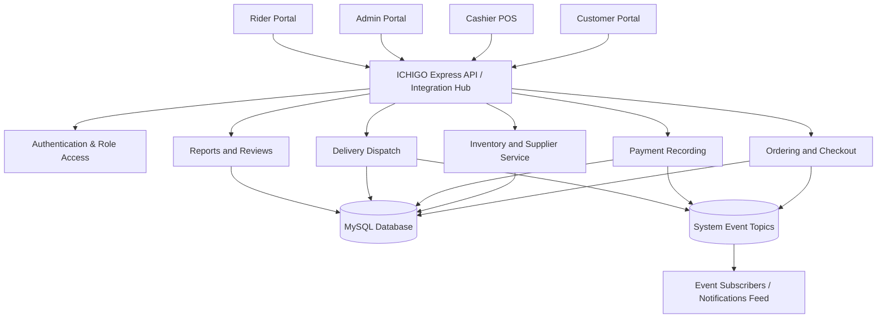
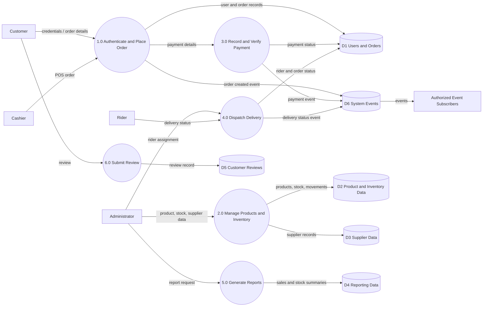
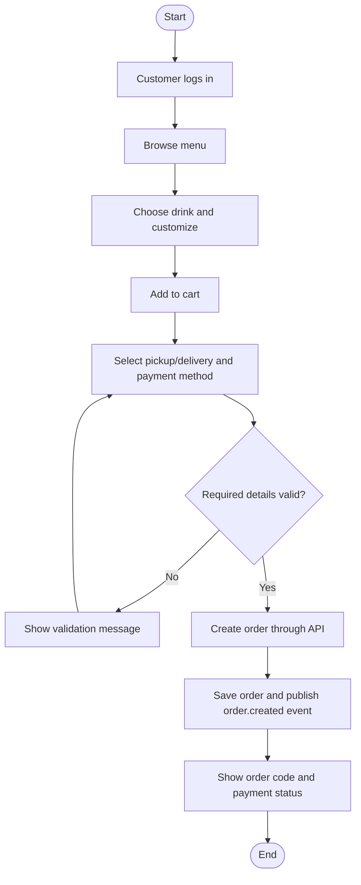
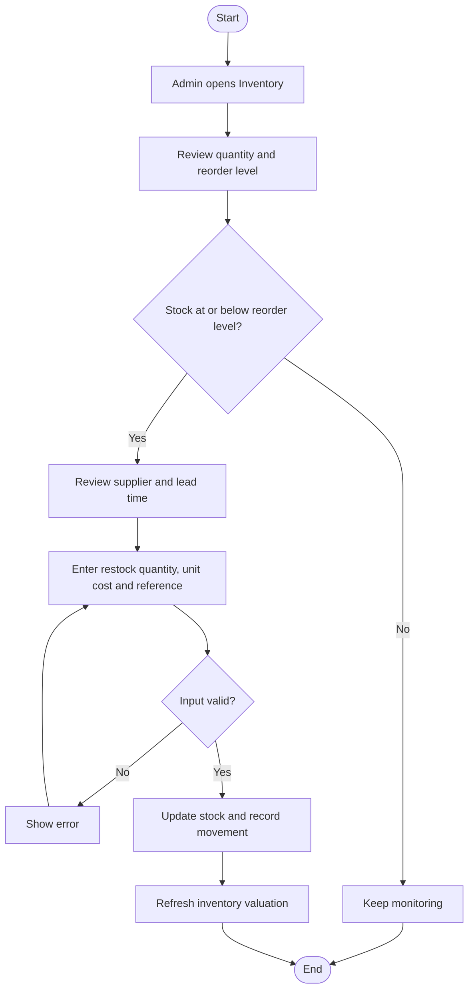
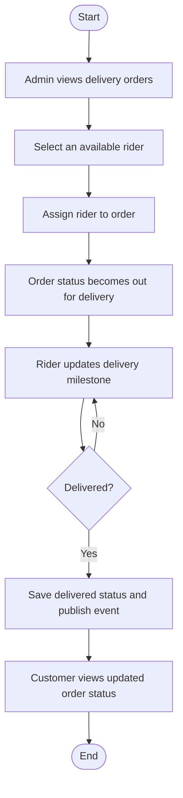

# ICHIGO Ordering System — SIA 101 Mini-Capstone Alignment

## 1. System concept

**System:** ICHIGO Ordering System  
**Tagline:** Your favorite milk tea, your way.

ICHIGO is a web-based milk tea ordering and store operations system. It connects customer ordering, cashier/POS transactions, inventory and supplier records, payment recording, delivery dispatch, business reporting, and order-event notifications. Customers can customize drinks, choose pickup or delivery, select a payment method, and monitor order status. Store staff manage the menu, orders, stock, suppliers, riders, and sales reports.

### Target users

| User | Main functions |
|---|---|
| Customer | Register/login, browse menu, customize drinks, checkout, view order status, submit reviews |
| Admin | Manage products, stock, suppliers, staff, orders, payment verification, dispatch, reports and settings |
| Cashier | Create POS orders, manage active queue and order history |
| Rider | View/claim delivery jobs and update delivery milestones |

## 2. Integrated subsystems

| Subsystem | Responsibility | Integration |
|---|---|---|
| Customer Ordering | Menu, customization, cart, checkout, order history | REST API to central application |
| Cashier / POS | Counter sales and order queue | Shares order service and database |
| Product & Inventory | Menu availability, ingredient stock, valuation, restock and stock movements | Inventory REST endpoints and MySQL |
| Supplier Management | Supplier directory and lead-time records | Linked to inventory items |
| Payment Recording | Payment method/status and manual verification | Order/payment REST endpoints |
| Delivery Management | Rider assignment, delivery board and status updates | Order service and event topic |
| Reporting & Notifications | Sales summaries and order/payment events | SQL reports and publish/subscribe event feed |

## 3. Architecture

The implementation uses a **client-server, layered architecture** with a central Express API acting as a hub. The browser portals are the presentation layer; Express routes contain authentication, authorization and business rules; MySQL stores users, products, orders, inventory, suppliers, reviews, stock movements and integration events.



## 4. Integration patterns

| Pattern | Where used | Why |
|---|---|---|
| Request-Response | Browser portals call `/api/login`, `/api/products`, `/api/orders`, `/api/inventory`, and other REST routes | The user needs an immediate success/error response for login, menu loading, checkout, restocking and status updates |
| Hub-and-Spoke | Express API is the central integration point for customer, POS, admin, rider, inventory, payment and reporting modules | Centralizes authentication, role checks, validation and routing instead of allowing every portal to connect directly to every other portal |
| Publish-Subscribe | Order creation and order/payment status changes publish records to `system_events`; authenticated clients can subscribe/poll through `GET /api/events` | Allows multiple authorized consumers to receive event updates without tightly coupling the publisher to each consumer |

**Implementation note:** the event feed is database-backed and retrieved by polling. It is not a dedicated RabbitMQ/Kafka broker or a push WebSocket connection. Payment method selection is recorded, but live GCash/Maya/QR Ph gateway settlement is not connected.

## 5. Level 1 Data Flow Diagram



## 6. Data flow table

| # | Source | Destination | Data type | Integration method | Frequency |
|---:|---|---|---|---|---|
| 1 | Customer Portal | Authentication API | Login credentials | REST POST `/api/login` | On demand |
| 2 | Customer Portal | Ordering API | Cart and customization | REST POST `/api/orders` | On demand |
| 3 | Cashier POS | Ordering API | Counter order | REST POST `/api/orders` | On demand |
| 4 | Ordering API | MySQL Orders | Order record and item snapshot | MySQL insert | Per order |
| 5 | Ordering API | System Events | `order.created` event | Publish-subscribe topic record | Per order |
| 6 | Admin Portal | Inventory API | Ingredient quantity and reorder level | REST GET/POST `/api/inventory` | On demand |
| 7 | Admin Portal | Inventory API | Restock quantity and unit cost | REST POST `/api/inventory/:id/restock` | Per restock |
| 8 | Inventory API | Stock Movements | Restock/adjustment record | MySQL insert | Per stock change |
| 9 | Admin Portal | Supplier API | Supplier and lead-time details | REST POST `/api/suppliers` | On demand |
| 10 | Admin/Cashier | Payment API | Payment verification status | REST PATCH `/api/orders/:id/payment` | Per payment update |
| 11 | Payment API | System Events | `payment.status.updated` event | Publish-subscribe topic record | Per payment update |
| 12 | Admin Portal | Dispatch API | Rider assignment | REST PATCH `/api/orders/:id/assign` | Per delivery |
| 13 | Rider Portal | Order API | Delivery milestone | REST PATCH `/api/orders/:id/status` | Per milestone |
| 14 | Admin Portal | Reporting API | Daily paid-sales summary | REST GET `/api/reports/daily` | On demand |
| 15 | Customer Portal | Reviews API | Rating and review text | REST POST `/api/reviews` | On demand |

## 7. Key process flows

### A. Customer order and checkout



### B. Inventory restocking



### C. Delivery dispatch and tracking



## 8. Wireframes / updated Figma mapping

The `Untitled (1).zip` contains the updated visual reference. The implemented pages map to these design groups:

| Figma screen group | Implemented page |
|---|---|
| ICHIGO welcome, login and registration | Public login/register screen |
| Menu/product catalogue | Customer Menu and Cashier POS |
| Customization, cart and checkout | Product customization and checkout flow |
| Order confirmation / receipt / status | Order confirmation response and My Orders status tracker |
| Inventory valuation and low-stock view | Admin Inventory |
| Buy inventory / restock | Admin Inventory restock action |
| Supplier lead time | Supplier form and supplier lead-time list |
| Daily sales / business reports | Admin Reports |
| Account/profile and customer feedback | Customer Profile and Reviews |

The Figma ZIP contains screen images, not editable Figma source files. Use the original Figma project to adjust component-level measurements and typography if needed.

## 9. Sample API endpoints

| Method | Endpoint | Purpose |
|---|---|---|
| POST | `/api/login` | Authenticate a user and return a token |
| GET | `/api/products` | Retrieve available products |
| POST | `/api/orders` | Place a customer or cashier order |
| GET/POST | `/api/inventory` and `/api/inventory/:id/restock` | Retrieve stock, add inventory items and record stock restock |
| GET | `/api/events?since=0` | Retrieve new integration events |

### Sample request — create order

```json
{
  "customer_name": "Sample Customer",
  "fulfillment": "pickup",
  "payment_method": "cash",
  "items": [
    {
      "product_id": 1,
      "quantity": 2,
      "size": "Large",
      "sugar": "50%",
      "ice": "Less ice",
      "toppings": ["Pearls"]
    }
  ]
}
```

### Sample event message

```json
{
  "topic": "order.created",
  "order_id": 104,
  "user_id": 12,
  "payload": {
    "orderCode": "ICH-123456789",
    "total": 218,
    "paymentStatus": "pending",
    "fulfillment": "pickup"
  }
}
```

## 10. Setup and database migration

1. Extract the project ZIP.
2. Start MySQL using XAMPP.
3. For a fresh database, import `database/schema.sql` in phpMyAdmin.
4. For an existing ICHIGO database, import `database/upgrade.sql`. It adds the inventory, supplier, review and event tables without dropping existing order/user data.
5. Open the extracted `ICHIGO` folder in VS Code (the folder containing `package.json`).
6. Run `npm install`.
7. Copy `.env.example` to `.env`, set the MySQL password and change `JWT_SECRET`.
8. Run `npm start` and open `http://localhost:3000`.

If port 3000 is already occupied, stop the existing Node process or change `PORT` in `.env` before restarting.

## 11. Current implementation limits

- Online payment options are recorded for manual verification; no live payment gateway is connected.
- The event feed uses database-backed polling, not WebSocket push or a separate message broker.
- Inventory quantities and restock movements are tracked, but ingredient consumption is not automatically calculated from drink recipes.
- Supplier lead time is recorded for planning; automated purchase orders and supplier API integration are not connected.
- The Figma provides screen images; the app uses responsive HTML/CSS/JavaScript and does not import editable Figma components.
- Test the project with your own MySQL data and accounts before submission.
